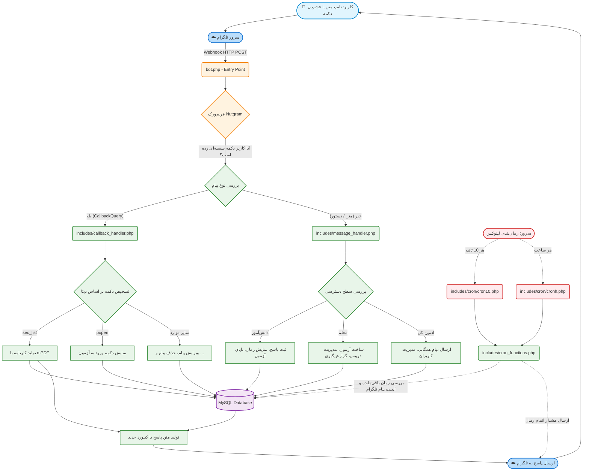

# منطق برنامه و چرخه پیام‌ها در ربات آزمونا

این دیاگرام مسیر دریافت، پردازش و پاسخ‌دهی به پیام‌های کاربران (مدیران، معلمان و دانش‌آموزان) را در ربات نشان می‌دهد.

### توضیحات:
1. **نقطه ورود (Entry Point)**: تلگرام تمام آپدیت‌ها را به `bot.php` که به عنوان وب‌هوک تنظیم شده است، ارسال می‌کند.
2. **Nutgram**: این فریم‌ورک تمام پیچیدگی‌های ارتباط با API را مدیریت کرده و درخواست‌ها را به هندلرهای مربوطه (`message_handler` یا `callback_handler`) هدایت می‌کند.
3. **پردازش پیام (Message Handler)**: بر اساس وضعیت (State) فعلی کاربر در دیتابیس و سطح دسترسی او (معلم/دانش‌آموز/ادمین)، پیام را تحلیل و ذخیره می‌کند.
4. **پردازش دکمه‌ها (Callback Handler)**: تمام کلیک‌های روی دکمه‌های شیشه‌ای را مدیریت می‌کند. برای مثال تولید PDF کارنامه‌ها در همین بخش با کمک `mPDF` صورت می‌گیرد.
5. **کارگران پس‌زمینه (Cron Jobs)**: به صورت مستقل از وب‌هوک کار می‌کنند و وظیفه دارند به طور مداوم دیتابیس را برای آزمون‌های فعال چک کنند و زمان باقی‌مانده را روی پیام تلگرام آپدیت نمایند.
